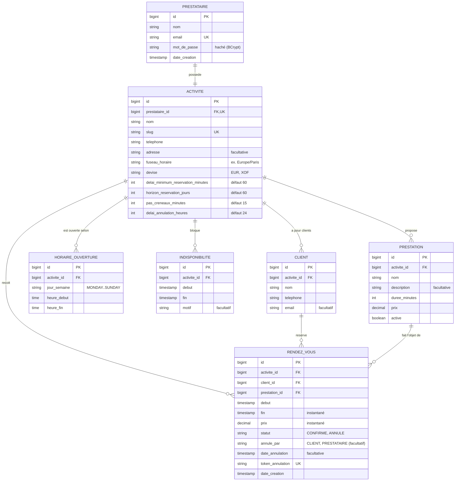

# Conception — rdv-api

> Document de conception du MVP. Il décrit **ce qu'on construit** et **pourquoi**.
> Il évoluera avec le projet : toute modification passe par une Pull Request.

---

## 1. Vision produit

Permettre à un **prestataire indépendant ou à un petit commerce** (coiffeur, barbier, esthéticienne, photographe…) de partager **un lien ou un QR code de réservation**, grâce auquel ses clients réservent en ligne, **sans créer de compte**, parmi des créneaux **calculés automatiquement** à partir de ses disponibilités.

Le produit vise aussi bien la France que l'Afrique de l'Ouest (Bénin) : il doit fonctionner pour des clients qui n'ont **pas d'adresse email**.

---

## 2. Utilisateurs et parcours

| Utilisateur | Compte | Ce qu'il fait |
|---|---|---|
| **Prestataire** | oui (email + mot de passe) | configure son activité, ses prestations, ses horaires, ses indisponibilités ; consulte et annule ses rendez-vous |
| **Client** | **non** | ouvre le lien du prestataire, choisit une prestation et un créneau, réserve ; annule via le lien reçu par email (s'il en a un) |

### Parcours principal

1. Le prestataire s'inscrit, configure son activité, ses prestations et ses horaires.
2. Il partage son lien (`/{slug}`) ou son QR code (WhatsApp, Instagram, affiche…).
3. Le client ouvre le lien, choisit une prestation, puis un jour.
4. L'application affiche les **heures disponibles**, calculées automatiquement.
5. Le client saisit son nom et son téléphone (et son email s'il en a un) : le rendez-vous est **confirmé immédiatement**.
6. S'il a donné un email, il reçoit une confirmation avec un **lien d'annulation**.
7. Le prestataire voit le nouveau rendez-vous dans son tableau de bord.

---

## 3. Décisions de conception

| # | Décision | Raison |
|---|---|---|
| D1 | **Un prestataire = une activité** dans le MVP, mais les deux entités sont **séparées** (relation 1-1). | Garder le MVP simple, tout en permettant de passer à plusieurs activités par prestataire sans restructurer la base. |
| D2 | **Le client n'a pas de compte.** Il réserve avec son nom et son téléphone. | Créer un compte fait abandonner beaucoup de clients. |
| D3 | **Téléphone obligatoire, email facultatif.** | Une partie des clients visés (notamment au Bénin) n'a pas d'email. |
| D4 | **Les créneaux ne sont pas stockés : ils sont calculés** à partir des horaires d'ouverture, des rendez-vous et des indisponibilités. | Le prestataire saisit ses horaires une seule fois ; chaque prestation, quelle que soit sa durée, trouve sa place. |
| D5 | **Les horaires sont des plages** (une ligne = un jour + une heure de début + une heure de fin). | Pauses, jours fermés et journées continues sont gérés sans cas particulier. |
| D6 | **Le rendez-vous copie la fin et le prix** au moment de la réservation (*instantané*). | Modifier la durée ou le prix d'une prestation ne doit pas modifier les rendez-vous déjà pris. |
| D7 | **Réservation confirmée immédiatement** dans le MVP (statuts `CONFIRME` / `ANNULE`). | La confirmation par code nécessite WhatsApp ou SMS pour les clients sans email : elle viendra plus tard. |
| D8 | **On ne supprime jamais un rendez-vous** : on change son statut. Une prestation utilisée est **désactivée**, pas supprimée. | Conserver l'historique. |
| D9 | **Le lien d'annulation utilise un jeton secret aléatoire**, jamais l'identifiant du rendez-vous. | Éviter qu'un client puisse annuler le rendez-vous d'un autre en modifiant l'URL (faille IDOR). |
| D10 | **Les réglages de réservation sont propres à chaque activité**, avec des valeurs par défaut. | Chaque prestataire a ses habitudes ; les valeurs par défaut évitent toute configuration obligatoire. |
| D11 | **Chaque activité a un fuseau horaire et une devise.** | Le produit vise la France (Europe/Paris, EUR) et le Bénin (Africa/Porto-Novo, XOF) : les heures et les prix doivent être interprétés correctement. |
| D12 | **Un client est rattaché à une activité** (unicité sur activité + téléphone). | Un prestataire ne doit pas voir les rendez-vous qu'un même client a pris chez un autre prestataire. |
| D13 | **L'API est versionnée et séparée** en partie publique (`/api/v1/public`) et partie prestataire (`/api/v1/prestataire`). | Préparer l'ouverture future de l'API à des sites externes sans casser l'existant. |
| D14 | **L'envoi des notifications passe par une interface** (`Notification` / `EnvoiCode`), avec une seule implémentation email dans le MVP. | Ajouter WhatsApp ou SMS plus tard sans modifier la logique de réservation (pattern Strategy). |
| D15 | **Authentification par jeton JWT émis par l'application**, signé avec une clé secrète et valable 8 h, sans jeton de rafraîchissement dans le MVP. L'API le vérifie avec le module standard *OAuth2 Resource Server* de Spring Security. Un serveur d'identité externe (Keycloak) a été écarté pour le MVP. | Une seule application, dont les comptes sont déjà en base : un serveur d'identité ajouterait un service à déployer et une migration des comptes, sans besoin réel. Le jeton garde l'API sans état. Le module standard permettra de passer plus tard à un fournisseur d'identité sans réécrire la vérification. |

---

## 4. Modèle de données

### 4.1 Diagramme



### 4.2 Précisions

- **`slug`** : identifiant lisible et unique de l'activité, utilisé dans le lien public (`/awa-coiffure`). Le QR code encode ce lien ; il est généré à la volée, rien n'est stocké.
- **`RENDEZ_VOUS.activite_id`** est redondant avec la prestation, mais volontaire : il simplifie et accélère la recherche des chevauchements, qui se fait par activité.
- **Dates et heures** : stockées en UTC (`timestamp with time zone`) ; converties dans le fuseau de l'activité pour l'affichage et le calcul des disponibilités.
- **`token_annulation`** : UUID aléatoire, généré à la création du rendez-vous.
- **Unicités** : `PRESTATAIRE.email`, `ACTIVITE.slug`, `ACTIVITE.prestataire_id` (1-1), `CLIENT (activite_id, telephone)`, `RENDEZ_VOUS.token_annulation`.

---

## 5. Règles métier

### Réservation
| # | Règle |
|---|---|
| R1 | Un rendez-vous ne peut pas chevaucher un autre rendez-vous **confirmé** ni une **indisponibilité** de la même activité. |
| R2 | La prestation doit **tenir entière** dans une plage d'ouverture (début et fin inclus dans la même plage). |
| R3 | On ne peut pas réserver dans le passé. |
| R4 | Le début doit respecter le **délai minimum** de l'activité (défaut : 1 h). |
| R5 | Le début ne peut pas dépasser l'**horizon** de l'activité (défaut : 2 mois). |
| R6 | Les heures de début proposées suivent le **pas** de l'activité (défaut : 15 min), à partir du début de chaque plage. |
| R7 | Seule une prestation **active** peut être réservée. |
| R8 | Le client fournit obligatoirement son **nom** et son **téléphone** ; l'email est facultatif. |

### Annulation
| # | Règle |
|---|---|
| R9 | Le client annule via son lien jusqu'au **délai d'annulation** de l'activité (défaut : 24 h avant). Après, il doit contacter le prestataire. |
| R10 | Le prestataire peut annuler n'importe lequel de ses rendez-vous, à tout moment. |
| R11 | Un rendez-vous annulé n'est jamais supprimé : il passe au statut `ANNULE`, avec qui a annulé et quand. Le créneau redevient libre. |

### Configuration
| # | Règle |
|---|---|
| R12 | Durée et prix d'une prestation : obligatoires et strictement positifs. |
| R13 | Une prestation qui a déjà des rendez-vous ne peut pas être supprimée, seulement **désactivée**. |
| R14 | Une plage horaire a une fin après son début ; deux plages d'un même jour ne se chevauchent pas. |
| R15 | Une indisponibilité a une fin après son début. |
| R16 | Le `slug` est unique dans toute l'application (minuscules, chiffres et tirets). |
| R17 | Réglages de réservation, avec leurs limites : pas ∈ {5, 10, 15, 30, 60} min ; délai minimum entre 0 et 48 h ; horizon entre 1 et 365 jours ; délai d'annulation entre 0 et 7 jours. |

### Sécurité
| # | Règle |
|---|---|
| R18 | Un prestataire ne voit et ne modifie **que ses propres données**. Les URL de l'espace prestataire ne contiennent pas d'identifiant d'activité : elle est déduite de l'utilisateur connecté. |
| R19 | Les mots de passe sont stockés hachés (BCrypt), jamais en clair. |
| R20 | La clé de signature des jetons est fournie par une variable d'environnement (au moins 256 bits) et n'est jamais écrite dans le dépôt. |
| R21 | En cas d'échec de connexion, le message est identique que l'email soit inconnu ou le mot de passe faux, pour ne pas révéler quels comptes existent. |

---

## 6. Calcul des disponibilités

Pour une activité, une prestation et un jour donnés :

```
heures disponibles = plages d'ouverture du jour
                     − rendez-vous confirmés
                     − indisponibilités
```

1. Récupérer les **plages d'ouverture** du jour de la semaine, dans le fuseau de l'activité.
2. Récupérer les **périodes occupées** de ce jour : rendez-vous `CONFIRME` et indisponibilités.
3. Pour chaque plage, générer les heures de début candidates selon le **pas** (R6).
4. Garder une heure de début si :
    - `début + durée` reste dans la plage (R2) ;
    - l'intervalle `[début, début + durée[` ne chevauche aucune période occupée (R1) ;
    - le délai minimum et l'horizon sont respectés (R3, R4, R5).

**Exemple** — plage 9 h – 12 h, rendez-vous existant 10 h – 10 h 45, prestation de 20 min, pas de 15 min :
proposés : 9 h 00, 9 h 15, 9 h 30, 10 h 45, 11 h 00, 11 h 15, 11 h 30.
(9 h 45 est exclu : il finirait à 10 h 05, pendant le rendez-vous existant.)

**Point technique à traiter à l'implémentation : la concurrence.** Deux clients peuvent réserver la même heure au même instant. La vérification R1 doit être garantie **par la base de données**, et pas seulement par le code (par exemple avec une contrainte d'exclusion PostgreSQL sur les intervalles, ou un verrou par activité).

---

## 7. API

Toutes les routes sont préfixées par `/api/v1`.

### 7.1 Publique — `/api/v1/public` (sans connexion)

| Méthode | URL | Rôle |
|---|---|---|
| GET | `/activites/{slug}` | Informations publiques de l'activité |
| GET | `/activites/{slug}/prestations` | Prestations actives |
| GET | `/activites/{slug}/disponibilites?prestationId=&date=` | Heures disponibles pour une prestation et un jour |
| POST | `/activites/{slug}/rendez-vous` | Réserver |
| GET | `/rendez-vous/{token}` | Consulter son rendez-vous via le lien |
| POST | `/rendez-vous/{token}/annulation` | Annuler via le lien |

### 7.2 Prestataire — `/api/v1/prestataire` (avec connexion)

| Méthode | URL | Rôle |
|---|---|---|
| POST | `/auth/inscription` | Créer un compte (et son activité) |
| POST | `/auth/connexion` | Se connecter |
| GET / PUT | `/activite` | Consulter / modifier son activité et ses réglages |
| GET / POST | `/prestations` | Lister / créer ses prestations |
| PUT | `/prestations/{id}` | Modifier une prestation |
| PATCH | `/prestations/{id}/desactivation` | Désactiver une prestation |
| GET / PUT | `/horaires` | Consulter / remplacer ses plages d'ouverture |
| GET / POST | `/indisponibilites` | Lister / créer ses indisponibilités |
| DELETE | `/indisponibilites/{id}` | Supprimer une indisponibilité |
| GET | `/rendez-vous?du=&au=` | Ses rendez-vous sur une période |
| POST | `/rendez-vous/{id}/annulation` | Annuler un rendez-vous |

Choix notables : l'annulation est un `POST` (on change un statut, on ne supprime rien — R11) ; les routes prestataire ne contiennent pas d'identifiant d'activité (R18).

---

## 8. Hors périmètre du MVP (évolutions)

- Confirmation de la réservation par **code** via **WhatsApp** (prioritaire pour le Bénin), puis **SMS** — avec les statuts `EN_ATTENTE` et `EXPIRE`.
- **Acompte** paramétrable par le prestataire (activation, montant fixe ou pourcentage, éventuellement par prestation), via **Mobile Money** ou carte bancaire.
- Gestion des **rendez-vous non honorés** (*no-show*).
- **Plusieurs employés** par activité, chacun avec ses horaires et son agenda.
- **Plusieurs activités** par prestataire.
- **Widget** à intégrer dans un site, puis **API ouverte** aux développeurs (clés d'API, limitation du nombre d'appels, CORS).
- Protection contre les **réservations abusives** (limite par téléphone ou par adresse IP).
- Rappels automatiques avant le rendez-vous.
- Rôle **administrateur** de la plateforme.
- **Serveur d'identité** (Keycloak) : mot de passe oublié, double authentification, connexion avec Google ; **jeton de rafraîchissement** et révocation des jetons.
